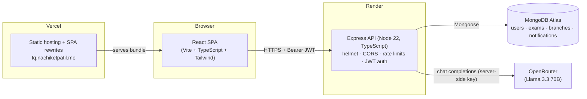
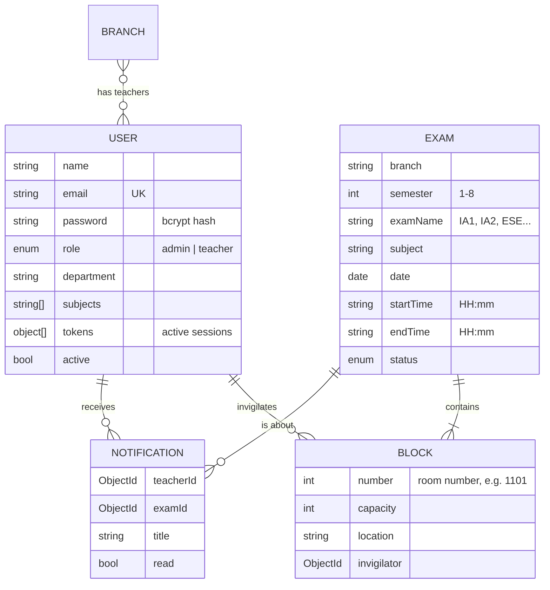
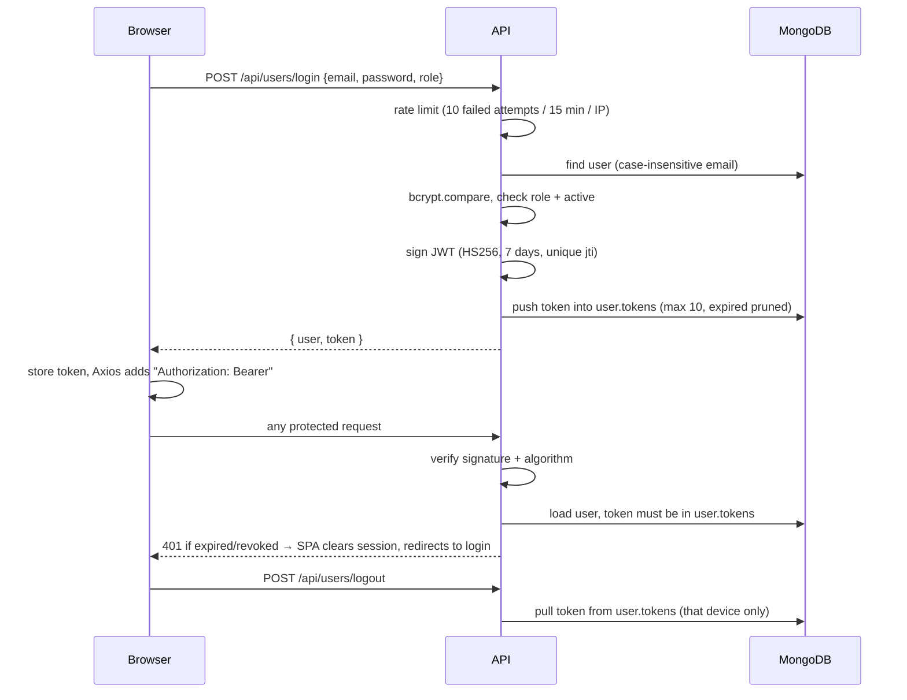
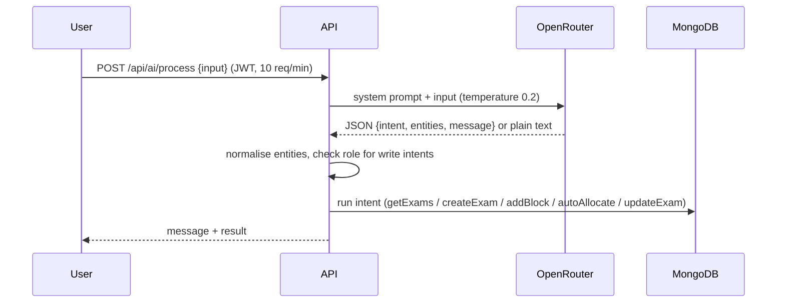

# TeachQuest – System Architecture

TeachQuest automates invigilation duty allocation for college unit tests. The exam coordinator (admin) builds the exam timetable, defines blocks (rooms) for each paper and allocates teachers to them, either by hand or with the auto-allocator. Teachers log in to see their duties and get notified when they are assigned.

This document describes how the system is put together and explains why the key decisions were made, including what each one trades away.

---

## 1. High-level overview



| Layer | Technology | Hosted on |
|---|---|---|
| Frontend | React 18, TypeScript, Vite 5, Tailwind CSS 3, React Router 6, Axios, Recharts, SheetJS (`xlsx`) | Vercel |
| Backend | Node 22, Express 4, TypeScript, Mongoose 7, JWT, bcrypt, helmet, express-rate-limit | Render |
| Database | MongoDB | MongoDB Atlas |
| AI assistant | OpenRouter chat completions API | OpenRouter |

### Repository layout

```
TeachQuest/
├── client/frontend/        React SPA (deployed to Vercel, vercel.json handles SPA routing)
│   └── src/
│       ├── components/     dashboards, timetable, allocation, ai assistant, common (navbar search, account modal)
│       ├── pages/          admin (analytics, teacher info) and teacher pages
│       ├── hooks/useAuth   session state (localStorage)
│       └── services/api    Axios instance + interceptors, typed API helpers
├── server/                 Express API (deployed to Render, render.yaml)
│   └── src/
│       ├── routes/         URL → middleware → controller wiring
│       ├── controllers/    request handling + business logic (allocation, AI intents)
│       ├── middleware/     protect / adminOnly / teacherOnly
│       ├── models/         Mongoose schemas
│       ├── services/       OpenRouter client, email templates
│       └── Seedscripts/    seed admin, teachers, exam data
├── render.yaml             backend infrastructure as code
└── ARCHITECTURE.md
```

---

## 2. Data model



**Blocks are embedded inside the exam document**, while teachers, branches and notifications are separate collections.

---

## 3. Key flows

### 3.1 Authentication and sessions



### 3.2 Exam setup and allocation

1. Admin picks **branch → semester → exam name** (e.g. *Computer Science → Sem 4 → IA2*). These choices form the URL, e.g. `/admin/timetable/Computer%20Science/4/IA2`.
2. Admin schedules papers. Clashing slots in the same semester are rejected.
3. Admin adds blocks (rooms) to each paper.
4. Allocation:
   - **Manual:** pick a block, then a teacher. The UI shows constraint hints ("Not available on this date", subject specialisation). The server independently rejects double-booking a teacher in overlapping exams.
   - **Auto:** `POST /api/exams/:id/auto-allocate` runs the allocator (see §4.6).
5. Each new assignment creates an in-app **notification** for the teacher. The teacher sees a badge count in the navbar.

### 3.3 AI assistant



---

## 4. Key decisions and why we made them

Each decision gives the context, the choice, why it is right for this project, and what it costs.

### 4.1 A single-page app plus a separate REST API

**Choice:** a React SPA talks to an Express JSON API, and the two are deployed separately.

**Why:**
- The workflow is highly interactive: timetable editing, block dialogs, allocation with live constraint hints and charts. A client-rendered SPA fits this better than server-rendered pages.
- A clean HTTP API boundary means the AI assistant, seed scripts and any future mobile client all use the same endpoints and the same authorisation rules.
- Frontend and backend can be deployed, scaled and debugged on their own.

**Trade-off:** the frontend and backend live on two origins, which means configuring CORS (§4.9) and dealing with cold starts on the API (§4.12). For an internal college tool both are acceptable.

### 4.2 TypeScript across both tiers

**Choice:** TypeScript on the frontend and backend. The backend compiles to JavaScript with `tsc` at build time and runs with plain `node`.

**Why:**
- Exams, blocks and allocations are nested data, and types catch shape mismatches (e.g. `invigilator` as an ID vs a populated object) at compile time.
- Running compiled JavaScript in production (rather than `ts-node`) means faster startup, lower memory use and no TypeScript toolchain at runtime.

**Trade-off:** a build step. `render.yaml` runs `npm ci --include=dev && npm run build` so the compiler is available during the build even when `NODE_ENV=production`.

### 4.3 MongoDB with blocks embedded in exams

**Choice:** a document database, with blocks stored as an array inside each exam.

**Why:**
- A block only makes sense inside its exam. It's always read, edited and deleted with its parent, so embedding gives a single read for the timetable and allocation screens and makes block updates atomic.
- Exam data is naturally document-shaped (variable numbers of blocks and allocated teachers), and the schema changed often while the project was being built.
- Atlas has a free tier with backups and a managed connection string, so there's no database server to run.

**Trade-off:** queries like "every duty of teacher X" have to scan `blocks.invigilator` across exams rather than join a table. At college scale (hundreds of exams per semester) that's negligible. Indexing `blocks.invigilator` is the next step if it ever grows.

### 4.4 Stateless JWT auth, with server-side session revocation

**Choice:** short-lived (7-day) HS256 JWTs sent as Bearer tokens, plus a per-user list of active tokens that the server checks on every request.

**Why:**
- A pure JWT can't be revoked: logging out only deleted it from the browser, so a copied token kept working for its full lifetime. Storing active tokens on the user turns logout into real server-side revocation, while keeping JWT's simple Bearer-header model.
- Every request already loads the user to check their role, so the extra session check costs no additional query.
- A unique `jti` per login makes each token distinct. Logging out on one device doesn't end sessions on others. (Without it, two logins in the same second produced identical tokens.)
- The algorithm is pinned to `HS256`, which blocks algorithm-confusion attacks such as tokens signed with `alg: none`.
- Expired tokens are pruned on login, and each user keeps at most 10 sessions, so the list can't grow without limit.
- The server refuses to start without `JWT_SECRET`, so a weak fallback secret can never reach production.

**Trade-off:** the token is stored in `localStorage`, so an XSS bug could read it. We accept that because the SPA renders no user-supplied HTML, helmet sets a strict Content-Security-Policy on the API, and httpOnly cookies across two domains (Vercel + Render) would need `SameSite=None`, CSRF protection and more complex CORS. Moving to httpOnly cookies behind a shared domain is the upgrade path.

### 4.5 Authorisation is enforced on the server; the frontend only decides what to show

**Choice:** every API route goes through `protect`, and admin routes also through `adminOnly`, which re-reads the role from the database. Teacher data endpoints enforce "only your own data" unless the caller is an admin.

**Why:**
- The SPA's route guard reads the role from `localStorage`, which anyone can edit. So the frontend guard only decides which screens to show. Editing a URL or local storage can reveal empty admin screens, but every data request behind them is rejected.
- Specific rules:
  - Registration is admin-only. The first admin comes from a seed script, so nobody can sign themselves up as an admin.
  - The teacher list (names, emails, phone numbers) is admin-only.
  - Teachers can read and edit only their own allocations, duties, stats and preferences. `me` resolves to the logged-in user.
  - The AI assistant checks the role again before any intent that writes data.
- Query parameters are cast to strings before reaching MongoDB, so `?examName[$ne]=x` can't become a database operator (NoSQL injection). Text the AI model supplies is regex-escaped before it's used in searches.

**Trade-off:** the database lookup per request (instead of trusting the role inside the JWT) costs a millisecond or two. In return, a role change or deactivation takes effect immediately.

### 4.6 The auto-allocation algorithm: a greedy heuristic, not an optimiser

**Choice:** a deterministic-enough greedy pass with these constraints:

| Rule | Type | Why |
|---|---|---|
| A teacher can't invigilate two exams whose times **overlap** on the same day | hard | Physical impossibility. Checked with real time-range overlap (`startA < endB && startB < endA`), not exact slot equality |
| A teacher gets at most one block per exam | hard | One person per room |
| Inactive teachers are skipped | hard | Deactivated staff shouldn't get duties |
| **Same room, same invigilator across the day** where possible | soft | Fewer handovers, and the invigilator already knows the room and seating. This mirrors how the department actually ran unit tests |
| Prefer the teacher with the **lowest number of duties that day** | soft | Spreads workload fairly. Duties already given in other exams that day count |
| Shuffle the candidate list before choosing | soft | Avoids always choosing the same people when workloads tie |
| Only newly assigned blocks get a notification | – | Re-running the allocator doesn't spam teachers |

**Why not an exact solver (ILP / constraint programming)?** A unit-test cycle in one department has a few dozen papers and tens of rooms. The greedy pass runs in milliseconds, its result is easy to explain to the coordinator ("lowest load, same room as the morning"), and every assignment can be overridden by hand. An optimiser would add a heavy dependency and make results harder to explain, for very little extra fairness at this scale.

**Trade-off:** greedy can paint itself into a corner, e.g. leaving a block unfilled when a smarter swap would have worked. The API then reports which block couldn't be filled, and the admin assigns it manually.

### 4.7 Defence in depth on double-booking

The UI warns about conflicts, the timetable rejects overlapping slots within a semester, and the server rejects manual assignments that clash with another exam the teacher is invigilating at the same time. **The server check is the one that counts**: the UI checks are for convenience and can be bypassed. The one exception is a teacher already covering the same room in a concurrent paper (shared rooms across branches), which is allowed.

### 4.8 In-app notifications instead of email (for now)

**Choice:** assignments create documents in a `notifications` collection. The teacher's navbar shows an unread badge, and opening a notification marks it read (scoped to the owner on the server).

**Why:** college Gmail accounts and SMTP from free hosting are unreliable: messages land in spam, hit rate limits, or need app passwords. In-app notifications always arrive and are queryable. The Nodemailer email template is kept in `services/emailService.ts` and can be switched on once a transactional email provider is configured.

### 4.9 Locked-down CORS, security headers and rate limiting

- **CORS:** allows only the origins listed in `CLIENT_URL` (comma-separated, e.g. the custom domain plus the `.vercel.app` address). Other origins get no CORS headers, so browsers block them.
- **helmet:** sets Content-Security-Policy, HSTS, `X-Content-Type-Options: nosniff` and frame protection.
- **Rate limits:**
  - Login: 10 failed attempts per 15 minutes per IP. Successful logins don't count, so real users aren't locked out.
  - AI assistant: 10 requests per minute. Every call costs OpenRouter credits.
- **`trust proxy`** is enabled because Render terminates TLS in front of the app. Without it, every request would appear to come from the proxy's IP and the rate limits would apply to all users at once.

### 4.10 OpenRouter for the AI assistant, called with `fetch`

**Choice:** the backend calls OpenRouter's OpenAI-compatible chat completions endpoint directly with Node's built-in `fetch`. The model is configurable with `OPENROUTER_MODEL` (default `meta-llama/llama-3.3-70b-instruct`).

**Why:**
- **Provider flexibility:** one API key gives access to many models, including free ones. Switching models is an environment variable change, not a code change.
- **No SDK dependency:** the request is one POST. Skipping an SDK keeps the bundle small and avoids being tied to one vendor's library.
- **The key never reaches the browser:** the frontend talks only to our API, which adds authentication, role checks and rate limiting before spending credits.
- **Structured output:** the model is asked to return `{intent, entities, message}` JSON at temperature 0.2 for consistency, with explicit rules for what each entity means. The server tolerates entities returned at the wrong level and asks the user for missing details (e.g. "Which branch?") instead of failing.

**Trade-off:** LLM output is still probabilistic, so the assistant is a convenience layer, not the primary interface. Every action it can take is also available, and validated, through the normal UI.

### 4.11 Excel export generated in the browser

**Choice:** timetable and teacher-allocation exports are built client-side with SheetJS from data already loaded on the page.

**Why:** the data is already in the browser, so generating the `.xlsx` there needs no extra endpoint, no server CPU and no file streaming, and it works even during an API cold start. Departments circulate timetables as Excel files, so this matches how the output is actually used.

### 4.12 Vercel for the frontend, Render for the API

**Choice:** static SPA on Vercel with a custom domain (`tq.nachiketpatil.me`). The Express API runs as a Render web service, defined in `render.yaml`.

**Why:**
- Vercel is built for static frontends: global CDN, automatic HTTPS for the custom domain, preview deployments, and `vercel.json` rewrites so URLs like `/admin/dashboard` work when refreshed.
- The API needs a long-running Node process with an open database connection pool. Render runs that as a normal web service, with health checks on `/api/health` and environment variables managed in one place. `render.yaml` keeps the setup reproducible as infrastructure as code.
- Both deploy automatically on every push to `main`.

**Trade-off:** Render's free plan sleeps after inactivity, so the first request after a while takes 30–60 seconds. A paid instance or a scheduled health-check ping removes this.

### 4.13 Configuration through environment variables

No secrets in the repo: `server/.env.example` and `client/frontend/.env.example` document every variable. `VITE_API_URL` is baked in at build time (only a public URL); everything sensitive (`MONGODB_URI`, `JWT_SECRET`, `OPENROUTER_API_KEY`, SMTP credentials) lives only in Render's environment.

---

## 5. API surface (summary)

| Area | Endpoints | Access |
|---|---|---|
| Auth | `POST /api/users/login`, `POST /api/users/logout`, `POST /api/users/register` | public (rate limited) / any user / admin |
| Profile | `GET/PUT /api/users/profile` | any user (own) |
| Teachers | `GET/POST /api/users/teachers`, `PUT/DELETE /api/users/teachers/:id` | admin |
| Teacher data | `/api/users/teachers/:id|me/{allocations,stats,duties/upcoming,preferences,expertise}` | admin, or the teacher themselves |
| Exams | `POST /api/exams`, `GET /api/exams/:branch?semester&examName`, `PUT/DELETE /api/exams/:id` | read: any user; write: admin |
| Blocks | `POST /api/exams/:id/blocks`, `PATCH/DELETE /api/exams/:id/blocks/:n`, `POST …/:n/invigilator` | admin |
| Allocation | `POST /api/exams/:id/allocate`, `POST /api/exams/:id/auto-allocate` | admin |
| Notifications | `GET /api/notifications`, `PUT /api/notifications/:id/read`, `PUT /api/notifications/mark-all-read`, `POST /api/notifications` | own / own / own / admin |
| Analytics | `GET /api/analytics?branch&semester` | admin |
| AI | `POST /api/ai/process` | any user (10/min); write intents admin-only |
| Health | `GET /api/health` | public |

---

## 6. Known limitations and next steps

- **Placeholder content left from the original student project:** the admin dashboard's stat cards and "Upcoming Examinations" table, and the teacher *Schedule* and *Remuneration* pages, show static sample data. The *Reports* and *Support* forms don't submit yet.
- **Branch list** on the admin dashboard is held in component state rather than loaded from the `branches` collection.
- **No automated tests yet.** Allocation logic and authorisation rules are the first candidates for Jest + Supertest (both already in `devDependencies`).
- **Token storage** in `localStorage` (see §4.4). The upgrade path is httpOnly cookies behind a shared domain.
- **Cold starts** on Render's free plan (see §4.12).
- **Email delivery** is implemented but disabled (see §4.8).
